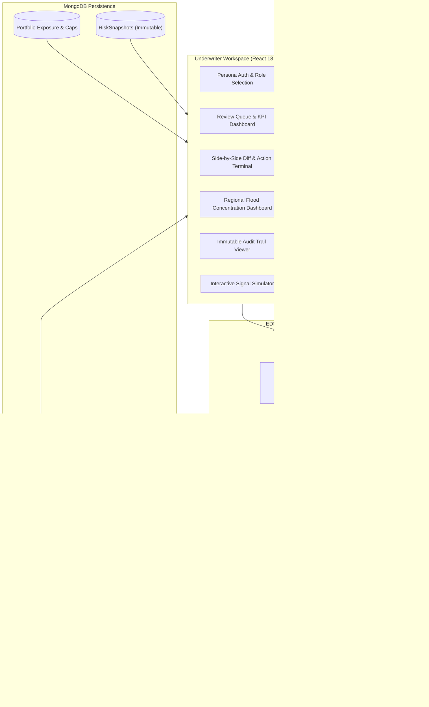

# Exposure Drift Sentinel (EDS)
### Real-Time Exposure Intelligence & Underwriter Decision Support for Guidewire PolicyCenter

[](https://www.typescriptlang.org/)
[](https://react.dev/)
[](https://vitejs.dev/)
[](https://nodejs.org/)
[](https://www.mongodb.com/)
[](https://tailwindcss.com/)
[](https://vitest.dev/)
[](LICENSE)

> **Disclaimer**: Concept project featuring a Guidewire PolicyCenter-inspired workflow. Not affiliated with, sponsored by, or endorsed by Guidewire Software, Inc. No proprietary logos or trademarks are used.

---

## 📌 Executive Summary

In commercial property insurance, policies are bound against an agreed schedule of locations, total insured values (TIV), and hazard classifications. In reality, commercial policyholders continuously evolve:
- **Unreported Facilities**: New construction, newly leased warehouses, or distribution centers added mid-term.
- **Valuation Creep**: Equipment additions or inventory growth expanding TIV far beyond bound coverage.
- **Dynamic Hazard Re-mapping**: FEMA updating local flood zones from Zone X (minimal risk) to Zone AE (high-hazard 100-year floodplain).

Traditionally, carriers discover this **"Exposure Drift"** only after a catastrophic hurricane, flood, or fire claim occurs.

**Exposure Drift Sentinel (EDS)** is an automated intelligence layer that listens to asynchronous real-world signals (building permits, tax assessor valuations, geospatial flood feeds), deterministically scores risk drift against the policy's approved baseline, and injects actionable **Underwriter Review Activities** directly into Guidewire PolicyCenter workflows.

---

## 🏗️ System Architecture



---

## ⚡ Core Principles & Constraints (By Design)

1. **Zero Black-Box LLM / 100% Explainability**:
   - Regulatory transparency requires exact auditability. All underwriting explanations and scores are synthesized deterministically from evaluated rules in [`server/rules.yaml`](server/rules.yaml).
2. **Never Auto-Alters Policy Terms or Pricing**:
   - EDS is purely a **decision-support copilot**. It creates tasks and recommendations; only licensed underwriters can accept exposure, request information, or dismiss events.
3. **Immutable Audit Trail**:
   - Every signal ingested, rule fired, activity assigned, and decision confirmed writes an append-only audit record with actor timestamping.
4. **Resilient MongoDB Support**:
   - Fully compatible with standard standalone MongoDB instances as well as multi-node replica sets (`rs0`).

---

## 🎯 Deterministic Rules Catalog

All underwriting thresholds live in [`server/rules.yaml`](server/rules.yaml). A cryptographic SHA-256 hash is computed on boot to detect configuration tampering or updates.

| Rule ID | Name | Trigger Condition | Points | Action / SLA |
| :--- | :--- | :--- | :---: | :--- |
| **`R1_TIV_INCREASE`** | TIV Growth (Moderate) | Total policy value increases by $10\%\text{--}25\%$ | **+3** | MEDIUM severity (5 business days) |
| **`R1_TIV_INCREASE`** | TIV Growth (Significant) | Total policy value increases by $\ge 25\%$ | **+5** | HIGH severity (2 business days) |
| **`R2_NEW_LOCATION`** | Location Schedule Expansion | Discovered unlisted commercial address | **+3** | Review building permit & schedule |
| **`R3_HIGH_FLOOD_ZONE`**| High Hazard Re-mapping | Enters FEMA Zone A, AE, or V | **+5** | HIGH severity & flood check |
| **`R4_FLOOD_SCORE_WORSENED`** | Hazard Deterioration | Flood risk index worsens by $\ge 2$ points | **+3** | Re-evaluation required |
| **`R5_COMBINED_ESCALATION`** | Compound Risk Override | New Location (R2) + High Flood (R3) fire | **FORCE HIGH** | Mandatory 2-day senior underwriting SLA |
| **`R6_PORTFOLIO_BREACH`** | Aggregate Appetite Cap | Territory flood TIV exceeds $20.00\%$ portfolio cap | **BREACH** | Flags treaty restriction banner |

### Scoring & Severity Tiers
- **HIGH** ($\ge 5$ pts) $\rightarrow$ 2 Business Days SLA (Senior Underwriter review if breached).
- **MEDIUM** ($3\text{--}4$ pts) $\rightarrow$ 5 Business Days SLA.
- **LOW** ($1\text{--}2$ pts) $\rightarrow$ 10 Business Days SLA (Reviewed at renewal).
- **IMMATERIAL** ($0$ pts) $\rightarrow$ Suppressed as baseline noise (no activity created).

---

## 🖥️ Screen-by-Screen Walkthrough

### 1. Persona-Based Login & Role Switcher
- Choose between configured personas:
  - **Priya Sharma** — Underwriter (Standard commercial property)
  - **Marcus Williams** — Senior Underwriter (Escalations & breaches)
  - **Aisha Patel** — Underwriter (Southeast territory specialist)
  - **Devon Torres** — Underwriter (New construction & TIV drift)
  - **Admin User** — System administration & full audit inspection
- Seamless profile switching directly from the top navigation bar with live reactive filtering.

### 2. Review Queue / Underwriter Desktop
- Live KPI cards: **Open Reviews**, **High Severity**, **Overdue SLAs**, and **Verify Match Gated**.
- Filter by severity, status, search string, or toggle **"Assigned to me"**.

### 3. Event Detail & Side-by-Side Diff Inspector
- **Before vs. After Comparison**: Clear visual highlights for new facilities (green) or modified attributes (amber).
- **Scoring Breakdown**: Detailed point receipts for each rule triggered.
- **Action Terminal**:
  - `Open & Start Review` $\rightarrow$ Transitions event from `ACTIVITY_CREATED` to `IN_REVIEW`.
  - `Accept Exposure` $\rightarrow$ Commits candidate state as the new official baseline snapshot; completes Guidewire activity.
  - `Request Information` $\rightarrow$ Puts policy into `INFO_REQUESTED` pending broker response.
  - `Dismiss Event` $\rightarrow$ Closes event with mandatory underwriter reason codes (*wrong entity match*, *not material*, *already known*).

### 4. Portfolio Exposure & Risk Appetite Monitoring
- Aggregates exposure across 4 US regions: **Midwest**, **North-East**, **South-East**, and **West**.
- Monitored against a strict **$20.00\%$ flood-hazard risk appetite cap** ($59.1\text{M} / 300\text{M}$ total TIV).
- Real-time headroom progress bars and contributing commercial policies breakdown.

### 5. Signal Simulator
- Interactive scenario runner to test and demonstrate system behaviors:
  - 🏗️ **New Facility Discovered** (Savannah GA warehouse $\rightarrow$ Fires R1 + R2 + R3 + R5 $\rightarrow$ South-East Cap Breach).
  - 📈 **TIV Increase on Existing Location** ($+40.6\%$ change $\rightarrow$ Medium severity).
  - 🌊 **Flood Hazard Re-mapping** (FEMA Zone X $\rightarrow$ Zone AE).
  - 🔍 **Ambiguous Entity Match** (Confidence $<0.75 \rightarrow$ `verifyFirst` gate).
  - 🔕 **Sub-Threshold Noise Signal** ($+2\%$ change $\rightarrow$ Suppressed).
  - 🔁 **Deduplication / E11000 Merge** (Rapid repeat submissions merged cleanly).
  - 🔄 **Reset Demo Baseline** (Instant one-click reset to deterministic demo data).

### 6. Audit Trail
- Filterable, immutable ledger of all system transactions (`DRIFT_EVENT`, `ACTIVITY`, `SIGNAL`, `PORTFOLIO_CONFIG`).
- Case-insensitive actor search, entity references, and detailed change payloads.

---

## 🚀 Quick Start Guide

### Prerequisites
- **Node.js**: v20 or higher
- **npm**: v10 or higher
- **MongoDB**: v6.0 or v7.0 running locally on port `27017`

### 1. Clone & Install
```bash
git clone https://github.com/ArpitSingh4010/Exposure-Drift-Sentinal.git
cd Exposure-Drift-Sentinal
npm install
```

### 2. Configure Environment Variables
The repository includes pre-configured defaults:

**Server** ([`server/.env`](server/.env)):
```env
NODE_ENV=development
PORT=4000
MONGO_URI=mongodb://localhost:27017/eds?replicaSet=rs0&directConnection=true
LOG_LEVEL=info
```
*(Note: EDS runs seamlessly on both standalone MongoDB instances and replica sets without code modifications).*

**Client** ([`client/.env`](client/.env)):
```env
VITE_API_BASE_URL=http://localhost:4000
```

### 3. Start Development Servers
From the root directory, start both the Express backend and Vite frontend:
```bash
npm run dev
```

- **Frontend Application**: [http://localhost:5173](http://localhost:5173)
- **Backend API Server**: [http://localhost:4000](http://localhost:4000)
- **Health Check**: [http://localhost:4000/health](http://localhost:4000/health)

---

## 🧪 Testing & Code Quality

EDS maintains comprehensive unit and integration test coverage:

```bash
# Run server test suite
npm run test

# Run client tests
cd client && npm test

# Run linter
npm run lint

# Production build validation
npm run build
```

---

## 📁 Repository Structure

```
exposure-drift-sentinel/
├── client/                      # React 18 + Vite Frontend
│   ├── src/
│   │   ├── api/client.ts        # Typed HTTP API client
│   │   ├── components/          # Reusable UI components & modals
│   │   │   ├── layout/          # TopBar, Sidebar, Breadcrumbs, Footer
│   │   │   ├── DecisionModal.tsx# Underwriter action modal
│   │   │   └── SeverityChip.tsx # Color-coded SLA chips
│   │   ├── hooks/               # User store & TanStack Query hooks
│   │   ├── pages/               # Desktop, EventDetail, Policies, Portfolio,
│   │   │                        # Simulator, Audit, Rules, Login
│   │   ├── index.css            # Design system, glassmorphism & tokens
│   │   └── App.tsx              # Application shell & route guards
│   └── package.json
│
├── server/                      # Node.js Express Backend
│   ├── rules.yaml               # Deterministic underwriting threshold config
│   ├── src/
│   │   ├── config/              # Rules loader, logger, environment
│   │   ├── models/              # Mongoose schemas (Policy, DriftEvent, AuditLog...)
│   │   ├── routes/              # Express API routers (events, signals, policies...)
│   │   ├── services/            # Pure business logic engines
│   │   │   ├── detection/       # Snapshot diffing engine
│   │   │   ├── materiality/     # Rule scoring & evaluation
│   │   │   ├── resolution/      # Fuzzy matching & entity resolution
│   │   │   ├── portfolio/       # Concentration & breach calculations
│   │   │   ├── events/          # State machine & transition lifecycle
│   │   │   └── signals/         # Ingestion orchestration & deduplication
│   │   ├── guidewireMock/       # PolicyCenter Activity integration adapter
│   │   └── seed/                # Deterministic $300M fixture data seeder
│   └── package.json
│
├── docker-compose.yml           # Full containerized stack configuration
└── README.md                    # Project documentation
```

---

## 🎬 3-Minute Demo Script

Want to see the full system in action? Follow these steps:
1. Open [http://localhost:5173/login](http://localhost:5173/login) $\rightarrow$ Select **Priya Sharma** $\rightarrow$ Click **Continue**.
2. Navigate to **Signal Simulator** in the sidebar.
3. Select scenario **"New Facility Discovered"** and click **Run Scenario**.
4. Observe the live result:
   - Policy `POL-100245` flagged with **HIGH Severity (13 points)**.
   - **Portfolio Appetite Breach** banner triggered (South-East crosses $20\%$ cap).
5. Click the generated **Drift Event link** to open the side-by-side comparison.
6. In the **Action Terminal**, click **"Open & Start Review"**.
7. Click **"Accept Exposure (Create Snapshot)"**, type a brief underwriting rationale note, and click **Confirm**.
8. Navigate to **Audit Trail** to observe the tamper-proof ledger tracking your decision, snapshot generation, and activity completion.

---

## 📄 License
This project is licensed under the MIT License — see the [LICENSE](LICENSE) file for details.