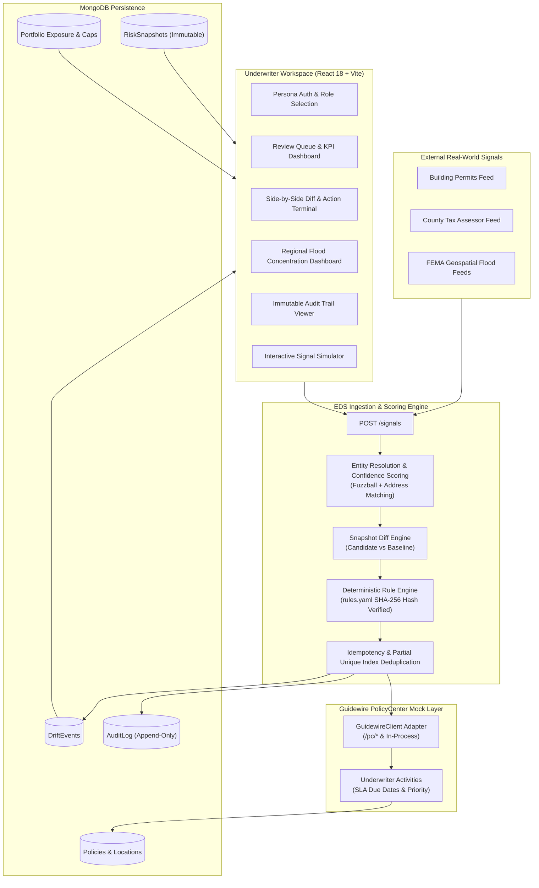

# Exposure Drift Sentinel (EDS)
### Real-Time Exposure Intelligence & Underwriter Decision Support for Guidewire PolicyCenter

[](https://www.typescriptlang.org/)
[](https://react.dev/)
[](https://vitejs.dev/)
[](https://nodejs.org/)
[](https://www.mongodb.com/)
[](https://tailwindcss.com/)
[](https://vitest.dev/)
[](LICENSE)

> **Disclaimer**: Concept project featuring a Guidewire PolicyCenter-inspired workflow. Not affiliated with, sponsored by, or endorsed by Guidewire Software, Inc. No proprietary logos or trademarks are used.

---

## 📌 Executive Summary

In commercial property insurance, policies are bound against an agreed schedule of locations, total insured values (TIV), and hazard classifications. In reality, commercial policyholders continuously evolve:
- **Unreported Facilities**: New construction, newly leased warehouses, or distribution centers added mid-term.
- **Valuation Creep**: Equipment additions or inventory growth expanding TIV far beyond bound coverage.
- **Dynamic Hazard Re-mapping**: FEMA updating local flood zones from Zone X (minimal risk) to Zone AE (high-hazard 100-year floodplain).

Traditionally, carriers discover this **"Exposure Drift"** only after a catastrophic hurricane, flood, or fire claim occurs.

**Exposure Drift Sentinel (EDS)** is an automated intelligence layer that listens to asynchronous real-world signals (building permits, tax assessor valuations, geospatial flood feeds), deterministically scores risk drift against the policy's approved baseline, and injects actionable **Underwriter Review Activities** directly into Guidewire PolicyCenter workflows.

---

## 🏗️ System Architecture



---

## ⚡ Core Principles & Constraints (By Design)

1. **Zero Black-Box LLM / 100% Explainability**:
   - Regulatory transparency requires exact auditability. All underwriting explanations and scores are synthesized deterministically from evaluated rules in [`server/rules.yaml`](server/rules.yaml).
2. **Never Auto-Alters Policy Terms or Pricing**:
   - EDS is purely a **decision-support copilot**. It creates tasks and recommendations; only licensed underwriters can accept exposure, request information, or dismiss events.
3. **Immutable Audit Trail**:
   - Every signal ingested, rule fired, activity assigned, and decision confirmed writes an append-only audit record with actor timestamping.
4. **Resilient MongoDB Support**:
   - Fully compatible with standard standalone MongoDB instances as well as multi-node replica sets (`rs0`).

---

## 🎯 How the Rules Work (Plain English Guide)

When a business changes in the real world, EDS checks **6 simple rules** to decide whether an underwriter needs to be alerted.

### 💡 The 30-Second Scoring Rule:
- 🔴 **High Priority (5+ points)**: Urgent review needed within **2 business days** (routed to Senior Underwriter).
- 🟡 **Medium Priority (3–4 points)**: Review within **5 business days**.
- 🟢 **Low Priority (1–2 points)**: Minor detail, review during annual renewal (**10 business days**).
- ⚪ **Ignored (0 points)**: Tiny changes under 10% are suppressed as routine background noise so underwriters aren't spammed.

---

### 📋 The 6 Rules Explained Simply

#### 1. 🏢 Rule 1: Property Value Jump (`R1_TIV_INCREASE`)
* **What happened?** The insured building or equipment became significantly more valuable than what the insurance policy currently covers.
* **When does it trigger?**
  - **Medium Alert (+3 pts)**: Property value increased by **10% to 25%**.
  - **High Alert (+5 pts)**: Property value jumped by **25% or more**.
  - **Ignored (0 pts)**: Tiny changes under 10% are considered normal inflation and ignored.
* **Why it matters**: If a fire burns the factory down today, the payout would be millions higher than what the company paid premiums for.
* **Real-World Story**: A factory bought new robotic manufacturing lines. Tax assessor records show their total property value leaped from $2.8M to $4.2M (+49%).
* **What happens next**: The underwriter adjusts the policy value and recalculates premium so the customer has sufficient coverage.

#### 2. 🏗️ Rule 2: Unreported New Building Discovered (`R2_NEW_LOCATION`)
* **What happened?** A new facility or warehouse was discovered that isn't written anywhere on the insurance policy.
* **When does it trigger?** Public municipal building permits or tax filings reveal an address belonging to the company that isn't on the policy. (**+3 points**)
* **Why it matters**: If an accident or explosion happens at this new location, the insurer has zero safety inspection records on file.
* **Real-World Story**: A policyholder constructs a 3rd commercial warehouse on Savannah Highway ($1.4M value), but forgets to notify their insurance agent.
* **What happens next**: An underwriter inspects the building specifications and officially binds an endorsement to add the property.

#### 3. 🌊 Rule 3: Danger Flood Zone Mapped (`R3_HIGH_FLOOD_ZONE`)
* **What happened?** Government flood maps updated: the building is now located in a severe flood danger zone.
* **When does it trigger?** FEMA officially re-maps the building's parcel into high-hazard flood areas (Zone A, AE, or coastal Zone V). (**+5 points $\rightarrow$ High Alert**)
* **Why it matters**: The building is now at high risk of water damage during the next major storm or hurricane season.
* **Real-World Story**: A warehouse originally sat on safe dry ground (Zone X). FEMA revised the local river basin boundaries, and the parcel is now inside the 100-year floodplain (Zone AE).
* **What happens next**: The underwriter verifies flood coverage sub-limits and ensures mandatory federal flood insurance compliance.

#### 4. 📈 Rule 4: Flood Risk Score Got Worse (`R4_FLOOD_SCORE_WORSENED`)
* **What happened?** Environmental risk deteriorated by 2 or more points on a 1–10 hazard scale.
* **When does it trigger?** The location's flood risk index worsens by $\ge 2$ points since the policy was bound. (**+3 points**)
* **Why it matters**: Local environmental conditions (like sea level rise or damaged seawalls) quietly increased the risk of claims without any physical changes to the building itself.
* **Real-World Story**: Coastal erosion washed away nearby dunes, increasing the warehouse's flood vulnerability score from 4/10 to 7/10.
* **What happens next**: The underwriter reviews engineering surveys and requires storm barriers or higher deductibles.

#### 5. ⚡ Rule 5: Double Trouble — New Building in a Flood Zone (`R5_COMBINED_ESCALATION`)
* **What happened?** Both Rule 2 and Rule 3 occurred at the same time: an uninspected new building was placed directly in a severe flood zone!
* **When does it trigger?** Whenever **Rule 2 (New Building)** and **Rule 3 (Danger Flood Zone)** fire on the same policy.
* **Outcome**: **UNCONDITIONALLY FORCES HIGH PRIORITY** (Bypasses point math, 2-day urgent SLA).
* **Why it matters**: This is the worst-case scenario: a brand-new, uninspected building placed in severe harm's way.
* **Real-World Story**: The customer built a new warehouse on Savannah Highway, and it happens to be located right inside flood Zone AE near the river.
* **What happens next**: Automatically routed to Marcus Williams (Senior Underwriter) for urgent treaty review before claims happen.

#### 6. 🛑 Rule 6: Company Safe Limit Exceeded (`R6_PORTFOLIO_BREACH`)
* **What happened?** The insurance company has too many flood-prone buildings concentrated in one geographic region (exceeding 20%).
* **When does it trigger?** Total property value in flood danger zones exceeds **20.00%** of the company's entire national portfolio ($300M total basis).
* **Outcome**: Triggers a **Red Warning Banner** and freezes binding authority in that territory.
* **Why it matters**: An insurance company cannot put all its eggs in one basket. If too many coastal policies are in Florida/Georgia, one single hurricane could bankrupt the insurer.
* **Real-World Story**: So many coastal policies were sold in the South-East that adding one more warehouse pushes the region to 20.07%, crossing the 20.00% safety limit.
* **What happens next**: A red warning banner is displayed across all underwriter screens; no new policies can be bound in that territory without executive sign-off.

---

### ⚖️ Priority Levels & Underwriter Response Times

| Priority Level | Score Required | Response Deadline | Assigned To | Underwriter Next Step |
| :--- | :---: | :---: | :--- | :--- |
| 🔴 **HIGH** | $\ge 5$ pts (or Rule 5) | **2 Business Days** | Senior Underwriter (`USR-002`) | Review exposure immediately; adjust pricing or initiate treaty referral |
| 🟡 **MEDIUM** | $3\text{--}4$ pts | **5 Business Days** | Assigned Underwriter | Review during normal weekly queue; request documents if needed |
| 🟢 **LOW** | $1\text{--}2$ pts | **10 Business Days** | Assigned Underwriter | Note details on the account; check during annual renewal cycle |
| ⚪ **IGNORED** | $0$ pts | *No action needed* | Filtered by System | Automatically suppressed as routine inflation noise |

---

## 🖥️ Screen-by-Screen Walkthrough

### 1. Persona-Based Login & Role Switcher
- Choose between configured personas:
  - **Priya Sharma** — Underwriter (Standard commercial property)
  - **Marcus Williams** — Senior Underwriter (Escalations & breaches)
  - **Aisha Patel** — Underwriter (Southeast territory specialist)
  - **Devon Torres** — Underwriter (New construction & TIV drift)
  - **Admin User** — System administration & full audit inspection
- Seamless profile switching directly from the top navigation bar with live reactive filtering.

### 2. Review Queue / Underwriter Desktop
- Live KPI cards: **Open Reviews**, **High Severity**, **Overdue SLAs**, and **Verify Match Gated**.
- Filter by severity, status, search string, or toggle **"Assigned to me"**.

### 3. Event Detail & Side-by-Side Diff Inspector
- **Before vs. After Comparison**: Clear visual highlights for new facilities (green) or modified attributes (amber).
- **Scoring Breakdown**: Detailed point receipts for each rule triggered.
- **Action Terminal**:
  - `Open & Start Review` $\rightarrow$ Transitions event from `ACTIVITY_CREATED` to `IN_REVIEW`.
  - `Accept Exposure` $\rightarrow$ Commits candidate state as the new official baseline snapshot; completes Guidewire activity.
  - `Request Information` $\rightarrow$ Puts policy into `INFO_REQUESTED` pending broker response.
  - `Dismiss Event` $\rightarrow$ Closes event with mandatory underwriter reason codes (*wrong entity match*, *not material*, *already known*).

### 4. Portfolio Exposure & Risk Appetite Monitoring
- Aggregates exposure across 4 US regions: **Midwest**, **North-East**, **South-East**, and **West**.
- Monitored against a strict **$20.00\%$ flood-hazard risk appetite cap** ($59.1\text{M} / 300\text{M}$ total TIV).
- Real-time headroom progress bars and contributing commercial policies breakdown.

### 5. Signal Simulator
- Interactive scenario runner to test and demonstrate system behaviors:
  - 🏗️ **New Facility Discovered** (Savannah GA warehouse $\rightarrow$ Fires R1 + R2 + R3 + R5 $\rightarrow$ South-East Cap Breach).
  - 📈 **TIV Increase on Existing Location** ($+40.6\%$ change $\rightarrow$ Medium severity).
  - 🌊 **Flood Hazard Re-mapping** (FEMA Zone X $\rightarrow$ Zone AE).
  - 🔍 **Ambiguous Entity Match** (Confidence $<0.75 \rightarrow$ `verifyFirst` gate).
  - 🔕 **Sub-Threshold Noise Signal** ($+2\%$ change $\rightarrow$ Suppressed).
  - 🔁 **Deduplication / E11000 Merge** (Rapid repeat submissions merged cleanly).
  - 🔄 **Reset Demo Baseline** (Instant one-click reset to deterministic demo data).

### 6. Audit Trail
- Filterable, immutable ledger of all system transactions (`DRIFT_EVENT`, `ACTIVITY`, `SIGNAL`, `PORTFOLIO_CONFIG`).
- Case-insensitive actor search, entity references, and detailed change payloads.

---

## 🚀 Quick Start Guide

### Prerequisites
- **Node.js**: v20 or higher
- **npm**: v10 or higher
- **MongoDB**: v6.0 or v7.0 running locally on port `27017`

### 1. Clone & Install
```bash
git clone https://github.com/ArpitSingh4010/Exposure-Drift-Sentinal.git
cd Exposure-Drift-Sentinal
npm install
```

### 2. Configure Environment Variables
The repository includes pre-configured defaults:

**Server** ([`server/.env`](server/.env)):
```env
NODE_ENV=development
PORT=4000
MONGO_URI=mongodb://localhost:27017/eds?replicaSet=rs0&directConnection=true
LOG_LEVEL=info
```
*(Note: EDS runs seamlessly on both standalone MongoDB instances and replica sets without code modifications).*

**Client** ([`client/.env`](client/.env)):
```env
VITE_API_BASE_URL=http://localhost:4000
```

### 3. Start Development Servers
From the root directory, start both the Express backend and Vite frontend:
```bash
npm run dev
```

- **Frontend Application**: [http://localhost:5173](http://localhost:5173)
- **Backend API Server**: [http://localhost:4000](http://localhost:4000)
- **Health Check**: [http://localhost:4000/health](http://localhost:4000/health)

---

## 🧪 Testing & Code Quality

EDS maintains comprehensive unit and integration test coverage:

```bash
# Run server test suite
npm run test

# Run client tests
cd client && npm test

# Run linter
npm run lint

# Production build validation
npm run build
```

---

## 📁 Repository Structure

```
exposure-drift-sentinel/
├── client/                      # React 18 + Vite Frontend
│   ├── src/
│   │   ├── api/client.ts        # Typed HTTP API client
│   │   ├── components/          # Reusable UI components & modals
│   │   │   ├── layout/          # TopBar, Sidebar, Breadcrumbs, Footer
│   │   │   ├── DecisionModal.tsx# Underwriter action modal
│   │   │   └── SeverityChip.tsx # Color-coded SLA chips
│   │   ├── hooks/               # User store & TanStack Query hooks
│   │   ├── pages/               # Desktop, EventDetail, Policies, Portfolio,
│   │   │                        # Simulator, Audit, Rules, Login
│   │   ├── index.css            # Design system, glassmorphism & tokens
│   │   └── App.tsx              # Application shell & route guards
│   └── package.json
│
├── server/                      # Node.js Express Backend
│   ├── rules.yaml               # Deterministic underwriting threshold config
│   ├── src/
│   │   ├── config/              # Rules loader, logger, environment
│   │   ├── models/              # Mongoose schemas (Policy, DriftEvent, AuditLog...)
│   │   ├── routes/              # Express API routers (events, signals, policies...)
│   │   ├── services/            # Pure business logic engines
│   │   │   ├── detection/       # Snapshot diffing engine
│   │   │   ├── materiality/     # Rule scoring & evaluation
│   │   │   ├── resolution/      # Fuzzy matching & entity resolution
│   │   │   ├── portfolio/       # Concentration & breach calculations
│   │   │   ├── events/          # State machine & transition lifecycle
│   │   │   └── signals/         # Ingestion orchestration & deduplication
│   │   ├── guidewireMock/       # PolicyCenter Activity integration adapter
│   │   └── seed/                # Deterministic $300M fixture data seeder
│   └── package.json
│
├── docker-compose.yml           # Full containerized stack configuration
└── README.md                    # Project documentation
```

---

## 🎬 3-Minute Demo Script

Want to see the full system in action? Follow these steps:
1. Open [http://localhost:5173/login](http://localhost:5173/login) $\rightarrow$ Select **Priya Sharma** $\rightarrow$ Click **Continue**.
2. Navigate to **Signal Simulator** in the sidebar.
3. Select scenario **"New Facility Discovered"** and click **Run Scenario**.
4. Observe the live result:
   - Policy `POL-100245` flagged with **HIGH Severity (13 points)**.
   - **Portfolio Appetite Breach** banner triggered (South-East crosses $20\%$ cap).
5. Click the generated **Drift Event link** to open the side-by-side comparison.
6. In the **Action Terminal**, click **"Open & Start Review"**.
7. Click **"Accept Exposure (Create Snapshot)"**, type a brief underwriting rationale note, and click **Confirm**.
8. Navigate to **Audit Trail** to observe the tamper-proof ledger tracking your decision, snapshot generation, and activity completion.

---

## 📄 License
This project is licensed under the MIT License — see the [LICENSE](LICENSE) file for details.