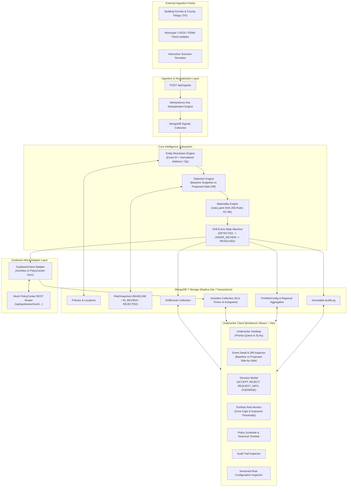
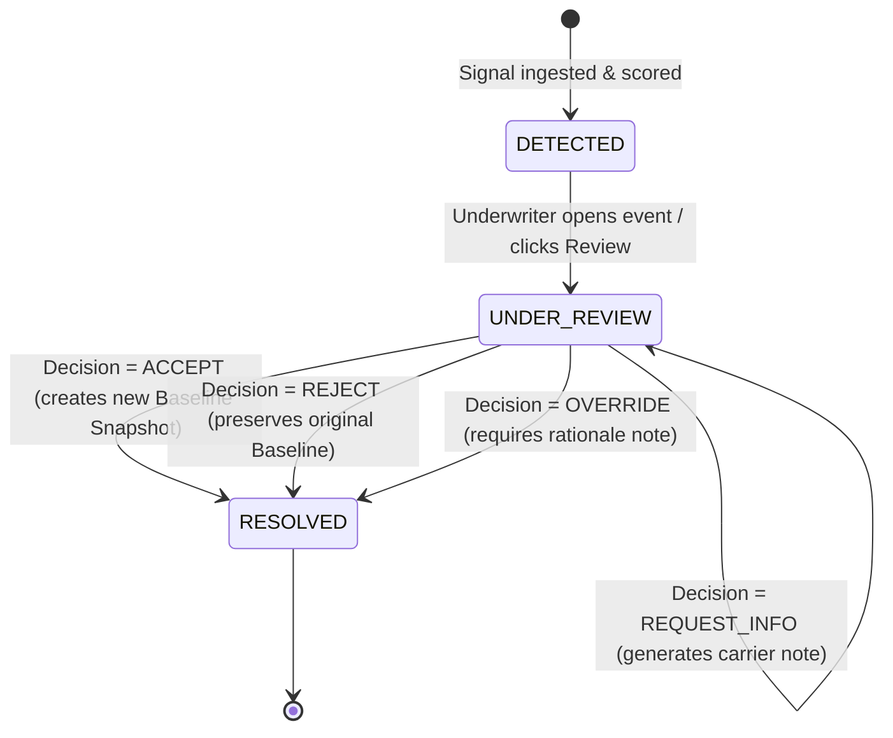
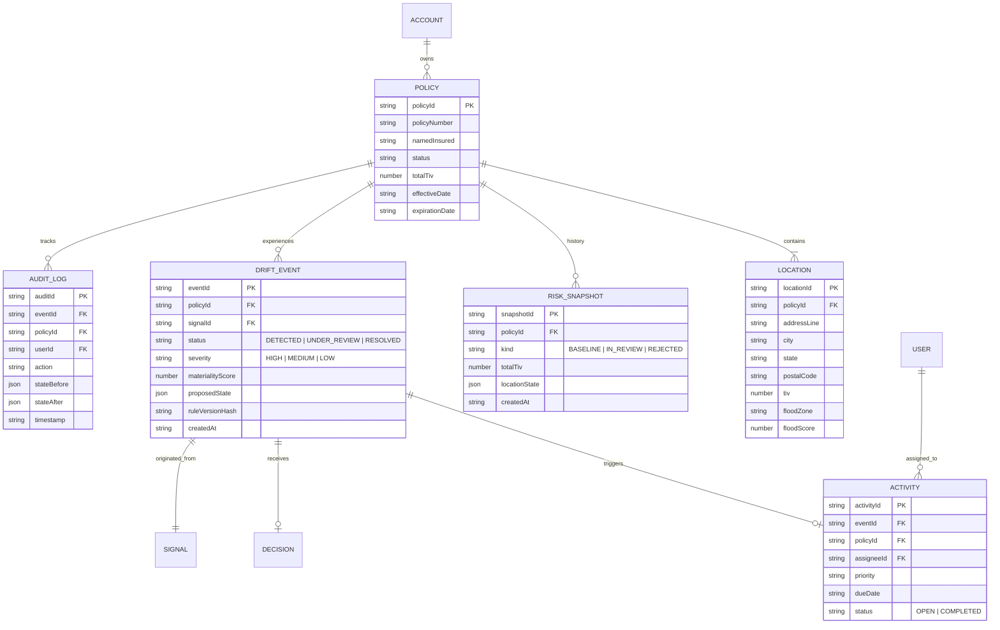
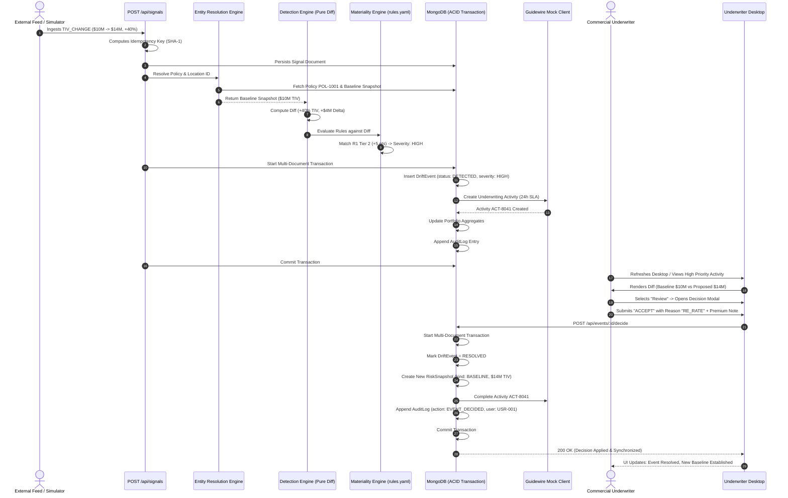

# Exposure Drift Sentinel (EDS) — System Architecture & Component Guide

**Course**: 21CSE734P | **Domain**: Commercial Property Insurance Intelligence  
**Technology Stack**: MERN + TypeScript (Node 20, Express, MongoDB 7 Replica Set, React 18, Vite, Tailwind CSS)  
**Integration Paradigm**: Guidewire PolicyCenter Decision-Support Pattern  

---

## 1. Executive Summary & Problem Space

In Commercial Property insurance, significant time elapses between initial underwriting/binding and the annual policy renewal. During this in-force lifecycle, insured properties dynamically change:
- Tenants expand warehouse capacity or add high-value inventory (**Total Insured Value / TIV drift**).
- New storage sheds, satellite facilities, or processing plants are constructed (**Unendorsed location drift**).
- Municipal flood mapping, FEMA FIRMs, or environmental hydrological assessments downgrade terrain into Special Flood Hazard Areas (**Flood hazard drift**).

Traditionally, insurers suffer from **Silent Exposure Drift**: unpriced, unmonitored risk accumulating on their balance sheets until an unexpected catastrophic loss or post-loss audit occurs.

**Exposure Drift Sentinel (EDS)** serves as an in-force decision-support intelligence layer. It sits alongside core policy administration systems (such as Guidewire PolicyCenter), continuously ingesting external building permits and geospatial hazard signals, calculating exposure delta against the last underwriter-approved baseline snapshot, scoring materiality using deterministic rules, and creating prioritized **Underwriter Review Activities**.

```
  ┌────────────────────────────────────────────────────────────────────────┐
  │                    EXPOSURE DRIFT SENTINEL (EDS)                       │
  │                                                                        │
  │   [External Signals]  ──► [Signal Ingestion & Deduplication]          │
  │                                    │                                   │
  │                                    ▼                                   │
  │   [Active Policies]   ──► [Entity Resolution Engine]                   │
  │                                    │                                   │
  │                                    ▼                                   │
  │   [Approved Baseline] ──► [Detection Engine (Pure Diff)]               │
  │                                    │                                   │
  │                                    ▼                                   │
  │   [rules.yaml (SHA)]  ──► [Materiality Scoring Engine]                 │
  │                                    │                                   │
  │                                    ▼                                   │
  │                       [Drift Event State Machine]                      │
  │                                    │                                   │
  │                                    ▼                                   │
  │                       [Guidewire Mock Activity Queue]                  │
  │                                    │                                   │
  │                                    ▼                                   │
  │                       [Underwriter Review Desktop]                     │
  │                        (ACCEPT / REJECT / REQUEST_INFO)                │
  │                                    │                                   │
  │                                    ▼                                   │
  │                      [Portfolio Re-aggregation & Audit]                │
  └────────────────────────────────────────────────────────────────────────┘
```

---

## 2. Core Architectural Invariants

EDS is engineered around strict domain safety principles:

| Invariant | Implementation Mechanism | Rationale |
|---|---|---|
| **Zero Black-Box / Zero LLM** | Deterministic pure functions in TypeScript driven by `rules.yaml`. | Insurance underwriting decisions and rating actions must withstand regulatory compliance scrutiny and DOI audits. |
| **Human Underwriter Primacy** | System never auto-reprices, auto-cancels, or automatically alters policy terms. | Automated policy alteration creates severe contractual liability. EDS generates decision-ready recommendations; human underwriters retain 100% binding authority. |
| **Pure Calculation Engines** | Detection, materiality, and portfolio math functions are side-effect free. | Zero database calls inside calculation loops ensure 100% testability, deterministic outputs, and sub-millisecond execution. |
| **ACID Multi-Document Transactions** | MongoDB 7 Replica Set sessions (`session.withTransaction`). | Atomic consistency prevents race conditions between incoming signals, event status updates, activity creation, and portfolio recalculation. |
| **Tamper-Evident Audit & Provenance** | Immutable append-only `AuditLog` collection + SHA-256 rule hashing. | Every decision, override, baseline update, and rule change is permanently recorded with exact timestamp, underwriter ID, and rule hash. |

---

## 3. High-Level System Architecture



---

## 4. Backend Subsystems & Component Breakdown

### 4.1. Signal Ingestion & Deduplication Service
- **Source Files**: [`server/src/services/signals/index.ts`](file:///c:/Users/arpit/OneDrive/Documents/Coding/guidewire/server/src/services/signals/index.ts), [`server/src/routes/signals.ts`](file:///c:/Users/arpit/OneDrive/Documents/Coding/guidewire/server/src/routes/signals.ts)
- **Role**: Receives asynchronous external telemetry describing real-world structural or environmental changes.
- **Idempotency Strategy**:
  - `TIV_CHANGE`: `sha1(policyId + "TIV_CHANGE" + locationId + tivDelta + effectiveDate)`
  - `NEW_LOCATION`: `sha1(policyId + "NEW_LOCATION" + normalize(addressLine) + postalCode)`
  - `FLOOD_UPDATE`: `sha1(policyId + "FLOOD_UPDATE" + locationId + newZone + newScore)`
- **Behavior**: Duplicate signals return `200 OK` with `{ status: "SKIPPED", duplicate: true }`, ensuring network retries never generate ghost drift events.

### 4.2. Entity Resolution Engine
- **Source Files**: [`server/src/services/resolution/index.ts`](file:///c:/Users/arpit/OneDrive/Documents/Coding/guidewire/server/src/services/resolution/index.ts)
- **Role**: Maps unorganized external records to active in-force insurance contracts.
- **Resolution Pipeline**:
  1. **Direct Identifier Resolution**: If `policyId` and `locationId` match an existing location, resolves immediately with `1.0` confidence.
  2. **Normalized Address Resolution**: Removes punctuation, trailing suite/unit designations, standardizes street abbreviations (e.g., `St` $\to$ `Street`, `Blvd` $\to$ `Boulevard`), and pairs with 5-digit postal code.
  3. **Verification Flagging**: Signals targeting unknown properties on an active policy are flagged `verifyFirst: true`, routing to an underwriter triage activity before mutating portfolio state.

### 4.3. Detection Engine (Pure Function Diffing)
- **Source Files**: [`server/src/services/detection/index.ts`](file:///c:/Users/arpit/OneDrive/Documents/Coding/guidewire/server/src/services/detection/index.ts)
- **Role**: Pure function comparator contrasting the **Baseline Risk Snapshot** against the **Proposed State**.
- **Calculations**:
  - `deltaTiv`: $\text{TIV}_{\text{proposed}} - \text{TIV}_{\text{baseline}}$
  - `pctTivChange`: $\frac{\text{deltaTiv}}{\text{TIV}_{\text{baseline}}} \times 100\%$
  - `isNewLocation`: Boolean flag indicating addition of a previously unendorsed insured premises.
  - `floodZoneDelta`: Ordinal comparison using hazard rank vector `['X', 'B', 'A', 'AE', 'V']`.
  - `floodScoreDelta`: Numeric delta $\text{Score}_{\text{new}} - \text{Score}_{\text{old}}$.

### 4.4. Materiality & Rules Engine
- **Source Files**: [`server/src/services/materiality/index.ts`](file:///c:/Users/arpit/OneDrive/Documents/Coding/guidewire/server/src/services/materiality/index.ts), [`server/rules.yaml`](file:///c:/Users/arpit/OneDrive/Documents/Coding/guidewire/server/rules.yaml)
- **Role**: Scores exposure delta and outputs human-readable underwriting explanations.
- **Rule Definitions**:
  - `R1_TIV_INCREASE`: Tiered scoring based on policy-level TIV expansion:
    - Tier 1 ($10\% \le \Delta < 25\%$): $+3\text{ points}$
    - Tier 2 ($\Delta \ge 25\%$): $+5\text{ points}$
  - `R2_NEW_LOCATION`: Addition of new location: $+3\text{ points}$
  - `R3_HIGH_FLOOD_ZONE`: Re-zoned or new facility in FEMA High-Risk Zones (`A`, `AE`, `V`): $+5\text{ points}$
  - `R4_FLOOD_SCORE_WORSENED`: Hazard index increase $\ge 2$: $+3\text{ points}$
  - `R5_COMBINED_ESCALATION`: Escalation rule enforcing `HIGH` severity if `R2` AND `R3` fire together.
  - `R6_PORTFOLIO_BREACH`: Regional aggregate flood share exceeding target appetite limit ($20\%$).
- **Severity Classification**:
  - **HIGH** ($\ge 5\text{ points}$): 24-hour SLA. Re-rate or referral recommended.
  - **MEDIUM** ($3 \text{ to } 4\text{ points}$): 48-hour SLA. Information request or scheduled inspection.
  - **LOW** ($1 \text{ to } 2\text{ points}$): 7-day SLA. Renewal note.

### 4.5. Drift Event Workflow & State Machine
- **Source Files**: [`server/src/services/events/workflow.ts`](file:///c:/Users/arpit/OneDrive/Documents/Coding/guidewire/server/src/services/events/workflow.ts), [`server/src/services/events/index.ts`](file:///c:/Users/arpit/OneDrive/Documents/Coding/guidewire/server/src/services/events/index.ts)
- **State Transition Graph**:



### 4.6. Guidewire PolicyCenter Mock Adapter
- **Source Files**: [`server/src/guidewireMock/client.ts`](file:///c:/Users/arpit/OneDrive/Documents/Coding/guidewire/server/src/guidewireMock/client.ts), [`server/src/guidewireMock/router.ts`](file:///c:/Users/arpit/OneDrive/Documents/Coding/guidewire/server/src/guidewireMock/router.ts)
- **Role**: Emulates bidirectional API contract with Guidewire PolicyCenter.
- **Functions**:
  - `createActivity()`: Creates an underwriting assignment with target completion date, priority, and link to the PolicyCenter policy file.
  - `completeActivity()`: Closes the activity in PolicyCenter when an underwriter accepts or rejects drift in EDS.
  - `syncPolicySnapshot()`: Mock endpoint demonstrating how a carrier's core ledger receives updated location schedules post-decision.

### 4.7. Activity & SLA Assignment Engine
- **Source Files**: [`server/src/models/Activity.ts`](file:///c:/Users/arpit/OneDrive/Documents/Coding/guidewire/server/src/models/Activity.ts), [`server/src/models/PortfolioConfig.ts`](file:///c:/Users/arpit/OneDrive/Documents/Coding/guidewire/server/src/models/PortfolioConfig.ts)
- **Role**: Orchestrates assignment across underwriting teams.
- **Round-Robin Assignment**: Persistent counter on `portfolioConfig.activityAssigneeIdx` cycles assignments across underwriters (`USR-001`, `USR-002`, `USR-003`).
- **SLA Calculation**:
  - `HIGH`: Current time $+ 24\text{ hours}$
  - `MEDIUM`: Current time $+ 48\text{ hours}$
  - `LOW`: Current time $+ 168\text{ hours}$ ($7\text{ days}$)

### 4.8. Portfolio Aggregation Engine
- **Source Files**: [`server/src/services/portfolio/index.ts`](file:///c:/Users/arpit/OneDrive/Documents/Coding/guidewire/server/src/services/portfolio/index.ts), [`server/src/routes/portfolio.ts`](file:///c:/Users/arpit/OneDrive/Documents/Coding/guidewire/server/src/routes/portfolio.ts)
- **Role**: Pure mathematical aggregation calculating systemic risk across all active policies.
- **Key Metrics**:
  - `totalTiv`: Sum of current TIV across all in-force policies.
  - `highFloodZoneTiv`: Total TIV situated within high-risk flood zones (`A`, `AE`, `V`).
  - `floodZoneExposurePct`: $\frac{\text{highFloodZoneTiv}}{\text{totalTiv}}$.
  - `isBreached`: Triggers alert if `floodZoneExposurePct` exceeds appetite threshold ($20\%$).

### 4.9. Audit Logging & Rule Provenance
- **Source Files**: [`server/src/services/audit/index.ts`](file:///c:/Users/arpit/OneDrive/Documents/Coding/guidewire/server/src/services/audit/index.ts), [`server/src/models/AuditLog.ts`](file:///c:/Users/arpit/OneDrive/Documents/Coding/guidewire/server/src/models/AuditLog.ts), [`server/src/models/RuleVersion.ts`](file:///c:/Users/arpit/OneDrive/Documents/Coding/guidewire/server/src/models/RuleVersion.ts)
- **Role**: Enforces non-repudiation and regulatory audit compliance.
- **Integrity Guarantee**:
  - At server startup, `rules.yaml` content is hashed using SHA-256. If modified, a new `RuleVersion` record is immutably created.
  - Every underwriting decision records the active `ruleVersionHash`, user ID, before/after snapshot IDs, and full rationale text.

---

## 5. Database Schema & Data Models



---

## 6. Frontend Architecture & Component Directory

The EDS client is built with React 18, Vite, and Tailwind CSS, following a high-end enterprise SaaS aesthetic inspired by Stripe, Linear, and Guidewire PolicyCenter.

```
client/src/
├── api/
│   └── api.ts                 # Typed REST client with X-User-Id impersonation header
├── components/
│   ├── DecisionModal.tsx      # Formal underwriting decisioning modal
│   ├── SeverityChip.tsx       # Standardized severity badge (HIGH / MEDIUM / LOW)
│   └── layout/
│       ├── TopBar.tsx         # Dark-slate enterprise navigation & underwriter switcher
│       └── Sidebar.tsx        # Linear-style navigation & real-time exposure meter
└── pages/
    ├── Desktop.tsx            # Primary Underwriter Desktop / Work Queue
    ├── EventDetail.tsx        # Drift event investigation & Baseline vs Proposed diff
    ├── Portfolio.tsx          # Portfolio accumulation & regional flood exposure
    ├── Policies.tsx           # Policy schedule, location list, and drift timeline
    ├── Simulator.tsx          # Interactive signal scenario injection workbench
    ├── Audit.tsx              # Tamper-evident immutable audit log viewer
    └── Rules.tsx              # Versioned underwriting rules inspector (SHA-256)
```

### Page & Component Specifications

| Component / View | Responsibilities | Key Data Attributes |
|---|---|---|
| **TopBar** ([TopBar.tsx](file:///c:/Users/arpit/OneDrive/Documents/Coding/guidewire/client/src/components/layout/TopBar.tsx)) | Header bar, primary tab routing, underwriter profile switcher (`USR-001`, `USR-002`, `USR-003`). | Propagates active user ID to `api.ts` via `X-User-Id` header for realistic RBAC impersonation. |
| **Sidebar** ([Sidebar.tsx](file:///c:/Users/arpit/OneDrive/Documents/Coding/guidewire/client/src/components/layout/Sidebar.tsx)) | Left navigation panel, quick filters, and live coastal flood exposure gauge. | Queries `/api/portfolio` to show high-risk TIV percentage against the $20\%$ appetite threshold. |
| **Underwriter Desktop** ([Desktop.tsx](file:///c:/Users/arpit/OneDrive/Documents/Coding/guidewire/client/src/pages/Desktop.tsx)) | Guidewire-style unified activity inbox. Shows overdue alerts, SLA countdowns, priority sorting, and unassigned event triage. | Filters by `My Activities`, `All Activities`, or `Severity`. One-click navigation to Event Detail. |
| **Event Detail & Diff Inspector** ([EventDetail.tsx](file:///c:/Users/arpit/OneDrive/Documents/Coding/guidewire/client/src/pages/EventDetail.tsx)) | Side-by-side comparison of **Baseline Snapshot** vs. **Proposed Changes**. Highlights delta values in amber/emerald. Displays triggered rules and recommended underwriting actions. | Contains the `Take Action` button launching `DecisionModal`. |
| **Decision Modal** ([DecisionModal.tsx](file:///c:/Users/arpit/OneDrive/Documents/Coding/guidewire/client/src/components/DecisionModal.tsx)) | Modal dialog for recording underwriting actions: `ACCEPT`, `REJECT`, `REQUEST_INFO`, or `OVERRIDE`. Captures reason codes and notes. | Accessible inputs with strict role/label attributes tested by automated Vitest suite. |
| **Portfolio Risk Monitor** ([Portfolio.tsx](file:///c:/Users/arpit/OneDrive/Documents/Coding/guidewire/client/src/pages/Portfolio.tsx)) | Aggregate balance sheet view. Breaks down Total Insured Value across Flood Zones `X`, `B`, `A`, `AE`, and `V`. Flags coastal threshold breaches. | Identifies policies with highest concentration in Special Flood Hazard Areas. |
| **Policy Schedule & History** ([Policies.tsx](file:///c:/Users/arpit/OneDrive/Documents/Coding/guidewire/client/src/pages/Policies.tsx)) | Searchable master policy roster. Shows location inventory, active coverage limits, and a historical timeline of all past drift events. | Slide-over drawer reveals detailed location-level construction and flood risk scores. |
| **Scenario Simulator** ([Simulator.tsx](file:///c:/Users/arpit/OneDrive/Documents/Coding/guidewire/client/src/pages/Simulator.tsx)) | Interactive demonstration tool. Injects pre-configured signals (`TIV +35%`, `New Warehouse in Flood Zone AE`, `FEMA Rezoning`, `Duplicate Signal`). | Live execution console displaying raw JSON payloads, response statuses, and execution timings. |
| **Audit Log Viewer** ([Audit.tsx](file:///c:/Users/arpit/OneDrive/Documents/Coding/guidewire/client/src/pages/Audit.tsx)) | Chronological record of all system events, state mutations, underwriter decisions, and baseline snapshot updates. | Filterable by action type (`SIGNAL_INGESTED`, `EVENT_DECIDED`, `SNAPSHOT_CREATED`). |
| **Rule Configuration Inspector** ([Rules.tsx](file:///c:/Users/arpit/OneDrive/Documents/Coding/guidewire/client/src/pages/Rules.tsx)) | Real-time viewer for active `rules.yaml` scoring rules, score tiers, and the computed SHA-256 integrity hash. | Allows underwriters to inspect exact threshold logic without accessing raw server source code. |

---

## 7. End-to-End Drift Lifecycle Sequence

The following sequence illustrates the complete processing journey of a high-value building expansion signal:



---

## 8. Deployment, Operation & Test Harness

### 8.1. Local Development (In-Process Replica Set)
EDS requires MongoDB transactions, which require a replica set. For zero-friction local development, EDS includes an embedded in-process replica set runner using `mongodb-memory-server`:

```bash
# Terminal 1 — Start Server with In-Process Replica Set (Port 4000)
cd server
npm run dev:local

# Terminal 2 — Start Frontend Development Server (Port 5173)
cd client
npm run dev
```

### 8.2. Containerized Production Setup
A multi-container Docker Compose definition is included in the project root:

```bash
docker compose up --build
```

- **`eds-mongo`**: MongoDB 7 configured as single-node replica set `rs0` with automatic initialization healthcheck.
- **`eds-server`**: Node 20 Express service exposing REST endpoints on port `4000` with direct connection to `eds-mongo`.
- **`eds-client`**: Vite development / preview server serving the React client on port `5173`.

### 8.3. Automated Verification Suites
The project maintains 100% test pass rates across unit, integration, and E2E layers:

| Layer | Runner | Command | Test Targets |
|---|---|---|---|
| **Server Unit & Integration** | Vitest | `npm test --workspace=server` | 51 tests across 11 suites (Detection, Materiality, Resolution, Events, Signals, Portfolio, Audit, Health). |
| **Client Component Tests** | Vitest + React Testing Library | `npm test --workspace=client` | DecisionModal interaction, accessible label validation, SeverityChip formatting. |
| **Client Type Safety** | TypeScript Compiler | `npm run typecheck --workspace=client` | Full JSX and API schema type validation (`tsc --noEmit`). |
| **End-to-End Integration** | Vitest E2E Suite | `npx vitest run tests/integration/e2e.test.ts` | Complete lifecycle from signal ingestion through decision, snapshot update, and audit log generation. |

---

## 9. Component Cross-Reference Directory

### Backend Services & Controllers
- [`server/src/app.ts`](file:///c:/Users/arpit/OneDrive/Documents/Coding/guidewire/server/src/app.ts) — Express application bootstrapping, CORS configuration, Swagger docs, and route mounting.
- [`server/src/server.ts`](file:///c:/Users/arpit/OneDrive/Documents/Coding/guidewire/server/src/server.ts) — HTTP server entry point with automatic database seeding upon empty startup.
- [`server/src/services/signals/index.ts`](file:///c:/Users/arpit/OneDrive/Documents/Coding/guidewire/server/src/services/signals/index.ts) — Signal ingestion and deduplication engine.
- [`server/src/services/detection/index.ts`](file:///c:/Users/arpit/OneDrive/Documents/Coding/guidewire/server/src/services/detection/index.ts) — Baseline vs. proposed risk delta detection engine.
- [`server/src/services/materiality/index.ts`](file:///c:/Users/arpit/OneDrive/Documents/Coding/guidewire/server/src/services/materiality/index.ts) — Deterministic scoring engine evaluating `rules.yaml`.
- [`server/src/services/resolution/index.ts`](file:///c:/Users/arpit/OneDrive/Documents/Coding/guidewire/server/src/services/resolution/index.ts) — Address normalization and policy entity resolver.
- [`server/src/services/events/workflow.ts`](file:///c:/Users/arpit/OneDrive/Documents/Coding/guidewire/server/src/services/events/workflow.ts) — Drift event state machine and transition manager.
- [`server/src/services/portfolio/index.ts`](file:///c:/Users/arpit/OneDrive/Documents/Coding/guidewire/server/src/services/portfolio/index.ts) — Regional exposure accumulator and threshold monitor.
- [`server/src/services/audit/index.ts`](file:///c:/Users/arpit/OneDrive/Documents/Coding/guidewire/server/src/services/audit/index.ts) — Immutable audit trail persistence helper.
- [`server/src/guidewireMock/client.ts`](file:///c:/Users/arpit/OneDrive/Documents/Coding/guidewire/server/src/guidewireMock/client.ts) — Guidewire PolicyCenter activity integration adapter.

### Frontend Application
- [`client/src/App.tsx`](file:///c:/Users/arpit/OneDrive/Documents/Coding/guidewire/client/src/App.tsx) — Top-level routing, shell layout, and view state management.
- [`client/src/api/api.ts`](file:///c:/Users/arpit/OneDrive/Documents/Coding/guidewire/client/src/api/api.ts) — Type-safe HTTP client with underwriter impersonation header.
- [`client/src/pages/Desktop.tsx`](file:///c:/Users/arpit/OneDrive/Documents/Coding/guidewire/client/src/pages/Desktop.tsx) — Underwriter review desktop and activity inbox.
- [`client/src/pages/EventDetail.tsx`](file:///c:/Users/arpit/OneDrive/Documents/Coding/guidewire/client/src/pages/EventDetail.tsx) — Drift event side-by-side comparison inspector.
- [`client/src/pages/Portfolio.tsx`](file:///c:/Users/arpit/OneDrive/Documents/Coding/guidewire/client/src/pages/Portfolio.tsx) — Portfolio risk analytics and flood concentration view.
- [`client/src/pages/Policies.tsx`](file:///c:/Users/arpit/OneDrive/Documents/Coding/guidewire/client/src/pages/Policies.tsx) — Policy schedule, location roster, and drift history timeline.
- [`client/src/pages/Simulator.tsx`](file:///c:/Users/arpit/OneDrive/Documents/Coding/guidewire/client/src/pages/Simulator.tsx) — Signal injection test harness.
- [`client/src/pages/Audit.tsx`](file:///c:/Users/arpit/OneDrive/Documents/Coding/guidewire/client/src/pages/Audit.tsx) — Immutable audit log viewer.
- [`client/src/pages/Rules.tsx`](file:///c:/Users/arpit/OneDrive/Documents/Coding/guidewire/client/src/pages/Rules.tsx) — Active `rules.yaml` and SHA-256 inspector.
